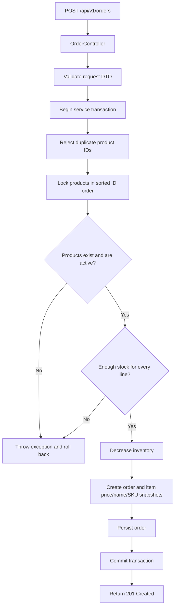
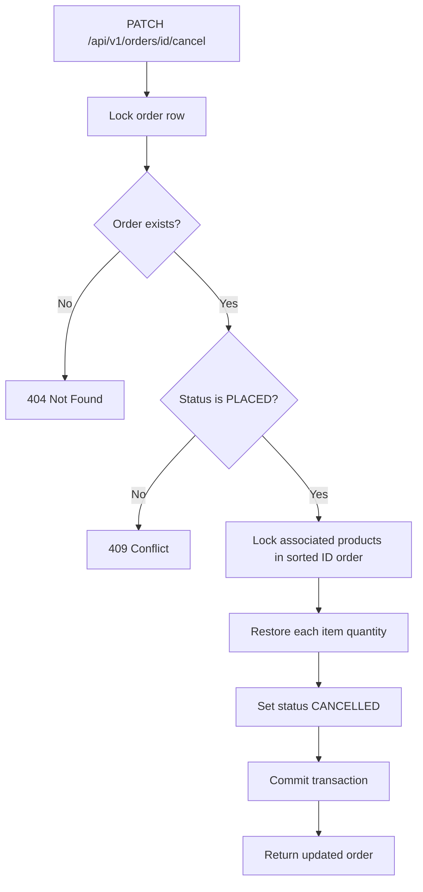
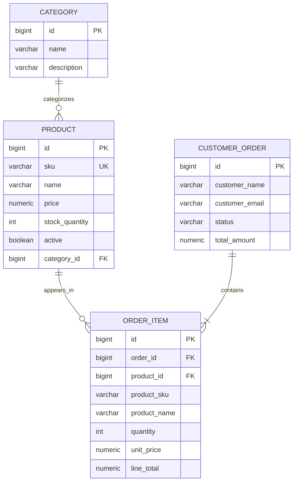

# ShopFlow Project Guide

## 1. Purpose

ShopFlow is a production-style e-commerce learning project. It is being built backend-first with Java 25, Spring Boot 4.1.1, PostgreSQL and Flyway. The current backend is a modular monolith; service extraction is a future architecture decision, not a current deployment topology.

## 2. Current modules

- `product`: product lifecycle, search/filter/pagination, stock adjustment and category association.
- `category`: category lifecycle and protection against deleting categories used by products.
- `order`: order creation, item snapshots, inventory reservation and cancellation.
- `common`: shared exception handling and pagination response DTO.
- `ShopflowApiApplication`: Spring Boot application entry point.

Typical request path:

```text
HTTP request
  -> REST Controller
  -> request DTO validation
  -> Service (business rules / transaction boundary)
  -> Spring Data JPA Repository
  -> PostgreSQL
  -> Response DTO
  -> HTTP response
```

Controllers expose DTOs, not persistence entities. Service classes implement business behavior. Flyway migrations are the source of schema evolution; Hibernate is configured to validate rather than create/update the schema automatically.

## 3. Order placement flow



The service validates all requested stock quantities before applying any inventory changes. Product row locks protect the inventory decision from concurrent order attempts. Database writes and stock changes share a transaction.

## 4. Order cancellation flow



A cancelled order retains its history. Repeated cancellation is rejected, preventing the same order from restoring inventory twice.

## 5. Product/category relationship



`orders` is the physical table name; the JPA entity is `CustomerOrder`. The order item stores purchase-time product details as snapshots while retaining a foreign key to the product.

## 6. Important implementation concepts

- DTO validation uses Jakarta Bean Validation.
- `@Transactional` keeps order persistence and inventory changes atomic.
- `PESSIMISTIC_WRITE` locks rows that are being modified by order operations.
- `BigDecimal` is used for monetary calculations.
- `Instant` stores timestamps.
- `OrderStatus` is persisted as a string enum.
- Flyway owns database schema migrations.
- Global exception handling maps known failures to HTTP error responses.

## 7. Current boundaries and planned capabilities

Implemented: product/category/order REST APIs, PostgreSQL persistence, Flyway, validation, basic exception handling, stock locking, and compile CI.

Planned: automated test phase, security/authentication/authorization, messaging, resilience, caching, observability, containerization, deployment automation, and Angular frontend. Do not describe planned items as available until implemented and verified.
