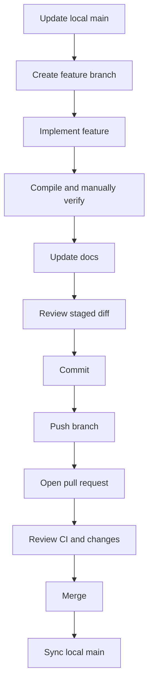

# Git Workflow

ShopFlow uses a feature-branch workflow. Feature code and its relevant documentation should be committed together.

## Feature workflow



## Typical PowerShell commands

Run from repository root:

```powershell
git switch main
git pull origin main
git switch -c feature/short-feature-name
```

After implementing and verifying:

```powershell
git diff --check
git status
git add <intended-files>
git diff --cached --check
git diff --cached --stat
git diff --cached
```

Inspect the staged diff before committing. In particular, ensure new Java files contain the complete source and that the intended SQL migration and documentation are staged.

```powershell
git commit -m "feat: describe feature"
git push -u origin feature/short-feature-name
```

Then open a pull request, review the changes and CI result, and merge using the repository's configured process.

After merge:

```powershell
git switch main
git pull origin main
git status
```

## Current testing policy

Automated tests are deferred until the main development phase is complete. During implementation, compile and perform relevant manual API checks. The automated test phase must be completed before treating the project as production-ready.

## Safety reminders

- Do not commit secrets or local database passwords.
- Do not edit migrations already applied to a shared database; create a new migration.
- Do not push until staged changes have been reviewed.
- Do not assume `git diff` includes untracked files. Stage intended files and inspect `git diff --cached`.
